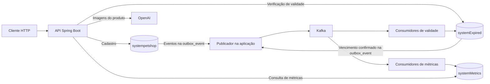

# SystemPetShop

API REST para cadastrar distribuidores, marcas e produtos de um pet shop, acompanhar lotes e vencimentos e consultar métricas de compra e venda. O backend usa Java 21, Spring Boot, MySQL e Apache Kafka. A leitura de rótulos por imagem usa Spring AI e OpenAI.

[Instalação local](#instalação-local) · [Fluxo do projeto](#fluxo-do-projeto) · [Primeiro cadastro](#primeiro-cadastro) · [Endpoints](#endpoints)

## Instalação local

O roteiro usa **PowerShell**, com a aplicação Java rodando na máquina e a infraestrutura no Docker. Você precisa de Git, JDK 21 e Docker com o comando `docker compose`. O Maven Wrapper acompanha o projeto. A primeira execução precisa de internet para baixar as imagens e as dependências.

### 1. Baixar o projeto

No GitHub, copie a URL em **Code → HTTPS**. Execute os próximos passos na mesma sessão do PowerShell.

```powershell
git clone (Read-Host 'Cole a URL HTTPS do repositório') SystemPetShop
cd SystemPetShop
java -version
docker compose version
```

### 2. Subir MySQL e Kafka

O exemplo usa **um contêiner MySQL para os três bancos** e um broker Kafka com ZooKeeper. A API acessa o MySQL em `127.0.0.1:3308` e o Kafka em `localhost:29092`. Se já usa serviços nessas portas, aproveite a infraestrutura existente e ajuste as conexões do passo 4.

Para um ambiente novo, salve o bloco abaixo como `compose.local.yaml` na raiz do projeto. O volume do MySQL preserva os dados entre reinicializações. A pasta `/setup` dá acesso aos scripts SQL dentro do contêiner.

```yaml
services:
  mysql:
    image: mysql:8.4
    environment:
      MYSQL_ROOT_PASSWORD: ${MYSQL_ROOT_PASSWORD:?defina MYSQL_ROOT_PASSWORD}
      MYSQL_USER: petshop
      MYSQL_PASSWORD: ${PETSHOP_DB_PASSWORD:?defina PETSHOP_DB_PASSWORD}
    ports:
      - "127.0.0.1:3308:3306"
    volumes:
      - mysql-data:/var/lib/mysql
      - ./src/main/resources/db/manual:/setup:ro

  zookeeper:
    image: confluentinc/cp-zookeeper:7.6.1
    environment:
      ZOOKEEPER_CLIENT_PORT: 2181
      ZOOKEEPER_TICK_TIME: 2000
    volumes:
      - zk-data:/var/lib/zookeeper/data
      - zk-log:/var/lib/zookeeper/log

  kafka:
    image: confluentinc/cp-kafka:7.6.1
    depends_on:
      - zookeeper
    ports:
      - "127.0.0.1:29092:29092"
    environment:
      KAFKA_BROKER_ID: 1
      KAFKA_ZOOKEEPER_CONNECT: zookeeper:2181
      KAFKA_LISTENERS: INTERNAL://0.0.0.0:9092,EXTERNAL://0.0.0.0:29092
      KAFKA_ADVERTISED_LISTENERS: INTERNAL://kafka:9092,EXTERNAL://localhost:29092
      KAFKA_LISTENER_SECURITY_PROTOCOL_MAP: INTERNAL:PLAINTEXT,EXTERNAL:PLAINTEXT
      KAFKA_INTER_BROKER_LISTENER_NAME: INTERNAL
      KAFKA_OFFSETS_TOPIC_REPLICATION_FACTOR: 1
    volumes:
      - kafka-data:/var/lib/kafka/data

volumes:
  mysql-data:
  zk-data:
  zk-log:
  kafka-data:
```

Escolha uma senha para administrar o MySQL e outra para o usuário da aplicação. A imagem usa esses valores ao inicializar o volume pela primeira vez. [Imagem oficial do MySQL](https://hub.docker.com/_/mysql) · [Configuração Docker da Confluent](https://docs.confluent.io/platform/7.6/installation/docker/config-reference.html)

```powershell
function Ler-Segredo($mensagem) {
    ([System.Net.NetworkCredential]::new('', (Read-Host $mensagem -AsSecureString))).Password
}
$env:MYSQL_ROOT_PASSWORD = Ler-Segredo 'Escolha a senha de root do MySQL'
$env:PETSHOP_DB_PASSWORD = Ler-Segredo 'Escolha a senha do usuário petshop'
docker compose -f compose.local.yaml up -d
docker compose -f compose.local.yaml ps
docker compose -f compose.local.yaml logs mysql
```

### 3. Preparar os bancos em uma instalação nova

As três conexões JPA usam `validate`. A aplicação verifica as tabelas durante a inicialização. Prepare a estrutura **uma vez, antes de iniciar a API**.

| Banco MySQL | Finalidade | Tabelas |
| --- | --- | --- |
| `systempetshop` | Cadastro e versionamento | `distributor_entity`, `brand_entity`, `product_entity`, `outbox_event` |
| `systemExpired` | Consulta e verificação de validade | As três tabelas de domínio e `outbox_event` |
| `systemMetrics` | Consultas de métricas alimentadas por eventos | As três tabelas de domínio |

Quando o MySQL estiver pronto para conexões, abra o cliente e digite a senha de root escolhida no passo 2.

```powershell
docker compose -f compose.local.yaml exec mysql mysql -u root -p
```

No prompt `mysql>`, execute este bloco **em um ambiente vazio**. A primeira parte cria as tabelas de cadastro e seus relacionamentos. Depois, o cliente executa os scripts do repositório para métricas e Outbox.

```sql
CREATE DATABASE systempetshop CHARACTER SET utf8mb4;
CREATE DATABASE systemExpired CHARACTER SET utf8mb4;
USE systempetshop;

CREATE TABLE distributor_entity (
    id_distributor BINARY(16) PRIMARY KEY,
    name_distributor VARCHAR(255) NOT NULL,
    localization_distributor VARCHAR(255),
    salespeople_distributor JSON,
    type_distributor VARCHAR(255) NOT NULL,
    telephones JSON,
    cnpj VARCHAR(255)
) ENGINE=InnoDB;

CREATE TABLE brand_entity (
    id_brand BINARY(16) PRIMARY KEY,
    id_distributor BINARY(16) NOT NULL,
    name_brand VARCHAR(255),
    type_brand VARCHAR(255),
    FOREIGN KEY (id_distributor) REFERENCES distributor_entity (id_distributor)
        ON DELETE CASCADE ON UPDATE CASCADE
) ENGINE=InnoDB;

CREATE TABLE product_entity (
    id_product BINARY(16) PRIMARY KEY,
    id_brand BINARY(16) NOT NULL,
    id_distributor BINARY(16) NOT NULL,
    name_product VARCHAR(255) NOT NULL,
    type_product VARCHAR(255),
    description_product VARCHAR(255) NOT NULL,
    data_created DATE,
    data_created_product DATE,
    data_due_product DATE,
    lot_product VARCHAR(255) NOT NULL,
    price_buy DOUBLE NOT NULL,
    price_sell DOUBLE NOT NULL,
    stock_product BIGINT NOT NULL,
    data_due_product_verify BIT(1) NOT NULL,
    version_product BIGINT NOT NULL,
    product_enable_due BIT(1) NOT NULL,
    FOREIGN KEY (id_brand) REFERENCES brand_entity (id_brand)
        ON DELETE CASCADE ON UPDATE CASCADE
) ENGINE=InnoDB;

CREATE TABLE systemExpired.distributor_entity LIKE systempetshop.distributor_entity;
CREATE TABLE systemExpired.brand_entity LIKE systempetshop.brand_entity;
CREATE TABLE systemExpired.product_entity LIKE systempetshop.product_entity;

-- CREATE TABLE ... LIKE copia as colunas e os índices. Recrie as relações de validade.
USE systemExpired;
ALTER TABLE distributor_entity
    MODIFY name_distributor VARCHAR(255),
    MODIFY type_distributor VARCHAR(255);
ALTER TABLE brand_entity
    MODIFY name_brand VARCHAR(255) NOT NULL,
    ADD FOREIGN KEY (id_distributor) REFERENCES distributor_entity (id_distributor) ON DELETE CASCADE;
ALTER TABLE product_entity
    MODIFY data_created DATE NOT NULL,
    MODIFY data_created_product DATE NOT NULL,
    MODIFY data_due_product DATE NOT NULL,
    MODIFY type_product VARCHAR(255) NOT NULL,
    MODIFY description_product VARCHAR(255),
    ADD FOREIGN KEY (id_brand) REFERENCES brand_entity (id_brand) ON DELETE CASCADE,
    ADD FOREIGN KEY (id_distributor) REFERENCES distributor_entity (id_distributor) ON DELETE CASCADE;

SOURCE /setup/2026-11-03-metrics-schema.sql
USE systempetshop;
SOURCE /setup/2026-11-04-outbox.sql
USE systemExpired;
SOURCE /setup/2026-11-04-outbox.sql

GRANT SELECT, INSERT, UPDATE, DELETE ON systempetshop.* TO 'petshop'@'%';
GRANT SELECT, INSERT, UPDATE, DELETE ON systemExpired.* TO 'petshop'@'%';
GRANT SELECT, INSERT, UPDATE, DELETE ON systemMetrics.* TO 'petshop'@'%';

SHOW TABLES FROM systempetshop;
SHOW TABLES FROM systemExpired;
SHOW TABLES FROM systemMetrics;
exit
```

Confira as três listagens com a tabela acima. Em uma base já populada, os comandos `CREATE TABLE ... LIKE` copiam apenas a estrutura. As leituras históricas de validade e métricas exigem uma carga separada. Para instalações antigas que ainda usam lotes numéricos, há também um [script de conversão do lote para texto](src/main/resources/db/manual/2026-10-29-lot-product-string.sql).

### 4. Iniciar a API

De volta ao PowerShell, configure a aplicação para usar o usuário criado nos três bancos e o endereço do Kafka acessível pela máquina. Informe sua chave OpenAI para usar a leitura de imagens. Para experimentar apenas o cadastro local, use um valor de teste como `local-sem-ia` no prompt da chave.

```powershell
$config = @{
    'spring.kafka.bootstrap-servers' = 'localhost:29092'
    'spring.ai.openai.api-key' = Ler-Segredo 'Chave OpenAI ou valor de teste local'
}
foreach ($banco in 'main', 'productexpired', 'productmetrics') {
    $config["app.datasource.$banco.username"] = 'petshop'
    $config["app.datasource.$banco.password"] = $env:PETSHOP_DB_PASSWORD
}
$env:SPRING_APPLICATION_JSON = $config | ConvertTo-Json -Compress
.\mvnw.cmd spring-boot:run
```

Em outro terminal, teste a API. A resposta esperada é `alo`.

```powershell
Invoke-RestMethod 'http://localhost:8080/distributor/teste'
```

Para parar, pressione `Ctrl+C` no terminal da aplicação e execute `docker compose -f compose.local.yaml stop` na sessão em que definiu as senhas. Nas próximas execuções com o mesmo volume, basta subir os serviços e iniciar a API com a configuração do passo 4.

## Fluxo do projeto



Ao cadastrar um produto, a aplicação grava o produto e os eventos na mesma transação do banco principal. O publicador lê a Outbox, envia os eventos ao Kafka e marca o envio após a confirmação do broker. Por isso, um produto recém-cadastrado pode aparecer na listagem principal antes de aparecer nas consultas de métricas e validade.

A verificação de um produto que atingiu o vencimento também gera um evento, desta vez no banco de validade. O banco de métricas apenas recebe os eventos que alimentam suas consultas. [Detalhes da Outbox e das retentativas](docs/OUTBOX.md)

## Primeiro cadastro

O cadastro segue a ordem **distribuidor → marca → produto**. Com a API em execução, rode este exemplo no PowerShell. Os IDs retornados em cada chamada alimentam a seguinte.

```powershell
$api = 'http://localhost:8080'
function Cadastrar($rota, $dados) {
    Invoke-RestMethod -Method Post -Uri "$api/$rota" -ContentType 'application/json; charset=utf-8' -Body ($dados | ConvertTo-Json)
}
$distribuidor = Cadastrar 'distributor/save' @{
    nameDistributor = 'Distribuidora Sul'
    localizationDistributor = 'Curitiba'
    salespeopleDistributor = @('Ana')
    typeDistributor = 'Atacado'
    telephones = @('41999999999')
    CNPJ = '11222333000181'
}
$marca = Cadastrar 'brand/save' @{
    idDistributor = $distribuidor.id
    nameBrand = 'Pet Sul'
    typeBrand = 'Alimentos'
}
$produto = Cadastrar 'product/save' @{
    idDistributor = $distribuidor.id
    idBrand = $marca.idBrand
    nameProduct = 'Ração para cães 1 kg'
    typeProduct = 'Ração'
    descriptionProduct = 'Alimento para cães adultos'
    dataCreatedProduct = (Get-Date).ToString('yyyy-MM-dd')
    dataDueProduct = (Get-Date).AddMonths(6).ToString('yyyy-MM-dd')
    lotProduct = '00042'
    priceBuy = 12.50
    priceSell = 18.90
    stockProduct = 30
    dataDueProductVerify = $false
    versionProduct = 1
}
Invoke-RestMethod "$api/product/all?idBrand=$($marca.idBrand)"
```

## Endpoints

URL base local: `http://localhost:8080`. Nas rotas abaixo, substitua `{uuid}` pelo identificador do cadastro. Os links na coluna de entrada abrem os campos aceitos no corpo JSON.

| Método | Rota | Entrada ou resultado |
| --- | --- | --- |
| GET | `/distributor/teste` | Testa o acesso HTTP e retorna `alo`. |
| GET | `/distributor/all?page=0` | Lista os distribuidores, com até 6 itens por página. O parâmetro `page` é obrigatório. |
| GET | `/distributor/metrics?page=0` | Lista os distribuidores, com até 9 itens por página. O parâmetro `page` é opcional e tem valor padrão `0`. |
| GET | `/distributor/metricDistributorTotal` | Retorna a lista completa de distribuidores, sem paginação. |
| GET | `/distributor/search?name=pet&page=0` | Busca distribuidores no banco principal por parte do nome, com até 6 itens por página. |
| GET | `/distributor/metrics/search?name=pet&page=0` | Busca distribuidores no banco de métricas por parte do nome, com até 6 itens por página. |
| POST | `/distributor/save` | Cadastra um distribuidor. [JSON](src/main/java/com/SystemPetShop/distributor/infrastructure/http/dto/DistributorDto.java) |
| PUT | `/distributor/edit` | Edita um distribuidor. [JSON](src/main/java/com/SystemPetShop/distributor/infrastructure/http/dto/DistributorEditDto.java) |
| DELETE | `/distributor/delete?id={uuid}` | Exclui o distribuidor. |
| GET | `/distributor/metricDistributor?idDistributor={uuid}` | Retorna os totais de compra e venda do distribuidor. |
| GET | `/brand/all?idDistributor={uuid}` | Lista as marcas do distribuidor. |
| GET | `/brand/metrics?idDistributor={uuid}&page=0` | Lista as marcas do distribuidor, com até 9 itens por página. `idDistributor` é obrigatório; `page` é opcional e tem valor padrão `0`. |
| GET | `/brand/metricsTotal?idDistributor={uuid}` | Retorna a lista completa de marcas do distribuidor, sem paginação. O parâmetro `idDistributor` é obrigatório. |
| GET | `/brand/search?name=pet&page=0` | Busca marcas no banco principal por parte do nome, com até 6 itens por página. |
| GET | `/brand/metrics/search?name=pet&page=0` | Busca marcas no banco de métricas por parte do nome, com até 6 itens por página. |
| POST | `/brand/save` | Cadastra uma marca para o distribuidor. [JSON](src/main/java/com/SystemPetShop/brand/infrastructure/http/dto/BrandDto.java) |
| PUT | `/brand/edit` | Edita uma marca. [JSON](src/main/java/com/SystemPetShop/brand/infrastructure/http/dto/BrandEditDto.java) |
| DELETE | `/brand/delete?id={uuid}` | Exclui a marca. |
| GET | `/brand/metricBrand?idBrand={uuid}` | Retorna os totais de compra e venda da marca. |
| GET | `/product/all?idBrand={uuid}` | Lista os produtos da marca no cadastro principal. |
| GET | `/product/search?name=racao&page=0` | Busca produtos no banco principal por parte do nome, com até 6 itens por página. |
| GET | `/product/metrics/search?name=racao&page=0` | Busca produtos no banco de métricas por parte do nome, com até 6 itens por página. |
| POST | `/product/save` | Cadastra um produto com marca, distribuidor e lote. [JSON](src/main/java/com/SystemPetShop/product/infrastructure/http/dto/ProductoDto.java) |
| POST | `/product/newVersion` | Cria uma versão do produto e desativa a anterior. [JSON](src/main/java/com/SystemPetShop/product/infrastructure/http/dto/ProductNewVersionDto.java) |
| PUT | `/product/edit` | Edita um produto. [JSON](src/main/java/com/SystemPetShop/product/infrastructure/http/dto/ProductEditDto.java) |
| DELETE | `/product/delete?idProduct={uuid}` | Exclui o produto. |
| POST | `/product/scan` | Extrai dados de imagens. Envie `multipart/form-data` com o campo `imgs` repetido para cada arquivo. |
| GET | `/product/metricProduct?idBrand={uuid}` | Lista os produtos da marca no banco de métricas. |
| GET | `/expired/findAll` | Lista produtos para acompanhamento de validade. |
| GET | `/expired/search?name=racao&page=0` | Busca produtos por parte do nome no banco expired, com até 6 itens por página e a versão mais recente de cada lote. |
| GET | `/expired/filter?dataDueProductVerify=true&page=0` | Filtra pelo boolean de verificação, com até 8 itens por página e a versão mais recente de cada lote. [Detalhes](docs/EXPIRED_FILTER.md) |
| PUT | `/expired/productExpiredVerify?idProduct={uuid}` | Verifica o prazo e registra o vencimento quando a data é atingida. |

A numeração das páginas começa em `0`. As rotas `/distributor/metricDistributorTotal` e `/brand/metricsTotal` retornam listas de cadastros sem paginação.

Os endpoints `/distributor/metricDistributor` e `/brand/metricBrand` respondem com `[somaDosPrecosDeCompra, somaDosPrecosDeVenda]`. O cálculo soma os preços unitários dos produtos habilitados. A quantidade em estoque fica fora da soma.

Para ler um rótulo com a IA, use sua chave OpenAI e substitua os caminhos pelas imagens locais. A rota retorna os dados extraídos para conferência. O cadastro é feito pelo endpoint `/product/save`.

```powershell
curl.exe -F "imgs=@frente.jpg" -F "imgs=@verso.jpg" http://localhost:8080/product/scan
```
